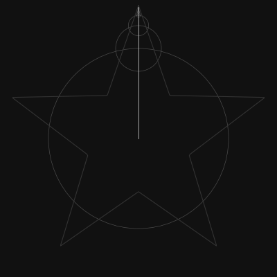

# Fourier epicycles

[](https://github.com/bushesarebetter/fourier-epicycles/actions/workflows/tests.yml)

Draws a closed 2D path with a chain of rotating circles. The path is treated as complex samples, run through a hand-written DFT, and the biggest terms become the circles.

[Preview](#preview) · [Setup](#setup) · [Run](#run) · [Tests](#tests)

## Preview



## Setup

```bash
pip install -r requirements.txt
```

## Run

```bash
python epicycles.py                                   # heart, 50 circles -> epicycles.gif
python epicycles.py --shape star --circles 30 --out demo.gif
python epicycles.py --image logo.png --circles 150    # trace the edges of an image
python epicycles.py --points path.txt --circles 40    # one "x y" or "x,y" pair per line
```

Built-in shapes are `heart`, `star`, `square` and `infinity`. For images, edge pixels come from the gradient magnitude and get chained together by nearest neighbour, so a clean silhouette on a plain background works best. `--samples` sets how many points the path is resampled to (default 512) and `--frames` sets the GIF length.

The script prints the RMS reconstruction error for the chosen number of circles.

## Tests

Install pytest separately from the runtime dependencies:

```bash
pip install pytest
```

```bash
python -m pytest -q
```

Checks the DFT against `np.fft.fft`, that error falls as circles are added, that a traced disk comes out as a ring, and that the GIF gets written.
